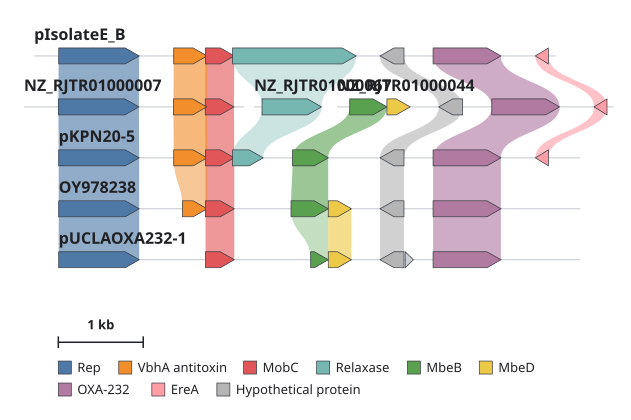

# Weft

Weft is a web application for comparing gene clusters. It aligns all proteins encoded in a
set of annotated nucleotide records against each other and draws the result as a multi-row
gene map. Cross-record similarity is shown as ribbons between the genes. The figure can be
edited interactively and exported as vector or raster graphics, with the underlying
similarity data exported as tables.



## Example data

**Load example dataset** in the app opens a precomputed session of ColKP3-type plasmids
carrying blaOXA-232: four complete plasmids deposited with different start positions, and one
draft assembly split across three contigs. The session loads as a static file, so nothing is
recomputed. The GenBank inputs, accessions, saved session and exported figure are in
[examples/OXA-232/](examples/OXA-232/).

[TUTORIAL.md](TUTORIAL.md) rebuilds this figure from the GenBank files step by step and covers
using your own data.

## Method

### Input

| Format | Extensions | Notes |
|---|---|---|
| GenBank | `.gbk` `.gb` `.genbank` `.gbf` `.gbff` | One file = one cluster. A multi-record file becomes one cluster with several loci, or, with **Split records** ticked for that file, one sequence per record (e.g. the contigs of a draft assembly), starting together in one row. |
| GFF3 / GTF + FASTA | `.gff` `.gff3` `.gtf` + `.fa` `.fna` `.fasta` `.fas` `.faa` | Annotation and sequence files are paired by basename (e.g. `phage1.gff3` + `phage1.fna`). |

Genes are taken from CDS features. Records with no CDS features are drawn but not aligned.

### Protein comparison

Every protein is compared with every protein from the other clusters. Three methods are
available:

| Method | Algorithm | Output per protein pair |
|---|---|---|
| Global (default) | Needleman–Wunsch, parasail; BLOSUM62, gap open 11, extend 1 | One alignment |
| Local | Smith–Waterman, parasail; same scoring | Up to 5 non-overlapping regions. After each alignment the matched query residues are masked and the search is repeated; regions shorter than 5 aa are discarded. |
| DIAMOND | DIAMOND blastp, all-vs-all | Best hit by bitscore; E-value cutoff 10⁻³ |

Metrics stored for each link:

- **Identity:** identical positions / alignment length (gaps included)
- **Similarity:** positive-scoring positions / alignment length
- **Coverage:** the smaller of the two aligned fractions (query span / query length, subject span / subject length)
- **Bitscore and E-value:** DIAMOND only

In local mode, each ribbon spans only the aligned region of each protein.

### Similarity groups

Genes are joined into a group when links at or above the identity cutoff chosen before
alignment connect them, either directly or through intermediate genes. Formally, the groups are the
connected components of the thresholded gene graph (single linkage); singletons are left
ungrouped. The groups are used for colouring and ordering. They are not homology or
orthology assignments, and they change with the cutoff.

### Cluster order

The initial row order comes from pairwise synteny scores between clusters:

S = (number of shared similarity groups) + 0.5 × (number of shared unordered pairs of adjacent groups)

Scores are converted to distances (max(S) − S) and clustered hierarchically (SciPy, Ward
linkage by default). The leaf order becomes the row order. With two or fewer clusters, or
when no groups are shared, the input order is kept.

## Interface

After alignment, the figure is edited client-side; changing the layout does not trigger a
new alignment. Supported operations:

- Filter the displayed links by any metric (identity, similarity, coverage; bitscore and
  E-value with DIAMOND) and threshold. Similarity groups are computed at the identity cutoff
  chosen before alignment; changing them requires running the alignment again.
- Reorder clusters, move them within or between rows, and reverse their orientation.
- Hide clusters from the figure and its exports (**Sequences → Sequence
  list**), and show them again in their original row.
- Align similar genes across rows on a selected gene.
- Mark records as circular and shift the displayed origin one CDS at a time.
- Colour genes by similarity group, by cluster, by any feature qualifier (e.g. `product`,
  `function`), or by user-defined groups.
- Inspect a gene: its qualifiers, similarity group, links with metric values, and protein
  sequence.

Canvas controls:

| Input | Action |
|---|---|
| Scroll / drag background / arrow keys | Pan |
| ⌘/Ctrl + scroll, pinch, `+` `−` | Zoom |
| `0` | Fit to window |
| Hover gene | Annotation summary |
| Right-click gene | Gene inspector |
| Double-click gene | Align matching genes across rows |
| Drag ⠿ handle | Move cluster within or between rows |
| ⌘Z / ⇧⌘Z (Ctrl on Windows/Linux) | Undo / redo |

## Output

| Export | Format | Content |
|---|---|---|
| Figure | SVG, PNG | Current view; PNG at a selectable scale |
| Link table | CSV | One row per link, with all metrics |
| Cluster matrix | CSV | Number of links between each pair of clusters |
| Session | JSON | Input-derived data, links, layout, colours and style; can be reopened in Weft |

The session is also autosaved to the browser's local storage. Up to 50 undo steps are kept.

## Installation

Docker:

```bash
git clone https://github.com/kciuchcinski/weft.git
cd weft
docker build -t weft .
docker run -p 8000:8000 weft     # http://localhost:8000
```

The image contains parasail and DIAMOND. It targets `linux/amd64`, so an Apple Silicon build should be possible, but it runs under emulation and may take several minutes to start.

From source (requires [pixi](https://pixi.sh) and Node.js 20). The pixi environment includes
DIAMOND.

```bash
cd backend && pixi install && pixi run dev     # API on http://localhost:8000
cd frontend && npm install && npm run dev      # http://localhost:5173, proxies /api to the backend
```

Tests:

```bash
cd backend && pixi run python -m unittest discover -s tests -t .
cd frontend && npm run build                   # type-check + production build
```

## Limits

Default per-job limits:

| Parameter | Default | Environment variable |
|---|---|---|
| Clusters | 100 | `MAX_CLUSTERS` |
| Genes, total | 6,000 | `MAX_TOTAL_GENES` |
| Protein length | 20,000 aa | `MAX_SEQUENCE_LENGTH` |
| Upload size | 50 MB | `MAX_UPLOAD_BYTES` (bytes) |
| Parasail: unique proteins | 800 | fixed |
| Parasail: protein length | 5,000 aa | fixed |

Server settings: `MAX_CONCURRENT_JOBS` (default 2), `JOB_TIMEOUT_SECONDS` (300),
`SCRATCH_TTL_SECONDS` (1,800) and `DEFAULT_ENGINE` (`parasail`).

Exact pairwise alignment scales quadratically with the number of proteins. Use DIAMOND for
larger inputs.

## Data handling

Uploaded files are deleted from the server 30 minutes after upload (`SCRATCH_TTL_SECONDS`). Figure state is stored
only in the user's browser and in session files the user saves.

## Citation

No publication yet. Until there is one, please cite the repository:
<https://github.com/kciuchcinski/weft>.

## Issues

Bug reports and feature requests: [GitHub Issues](https://github.com/kciuchcinski/weft/issues).

## License

[MIT](LICENSE) © 2026 Karol Ciuchciński
